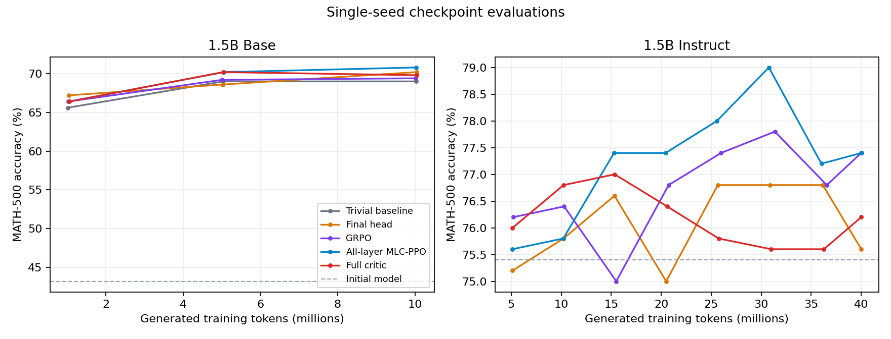

# Multi-Layer Critic PPO for LLMs

An experimental RLVR codebase for testing whether lightweight value heads attached to a language model's transformer layers can replace a separate full-transformer PPO critic. The project compares all-layer MLC-PPO with a final-layer head, a separate full critic, GRPO, and a simple leave-one-out batch baseline.

**Status: research prototype.** The completed 1.5B comparisons use one seed per method. They show competitive performance and lower measured memory for MLC-PPO, but do not establish a statistically reliable architecture advantage. The 4B POLARIS comparison is in preparation; its training results are not yet available.

## Method

For a response prefix \(s_t=(x,y_{<t})\), the hidden state **before** token \(y_t\) is consumed is extracted from each transformer layer. A small critic head maps the detached activation to \(V_l(s_t)\). The all-layer baseline and Monte Carlo advantage are

\[
 B(s_t)=\frac{1}{L}\sum_{l=1}^{L}V_l(s_t),\qquad \hat A_t=R-B(s_t).
\]

The response receives binary correctness reward \(R\). The actor uses a clipped PPO objective and detached advantages. Each value head is trained on rollout-time representations; its loss does not backpropagate into the policy. Other supported variants use final-layer heads, group-relative GRPO advantages, a separate critic, or a leave-one-out batch reward mean. The 1.5B all-layer runs use **28 heads**. Number of heads is derived from the actual model configuration for other models.

## Completed results

| Initialization and budget | Trivial baseline | Final-head PPO | GRPO | All-layer MLC-PPO | Full-critic PPO |
|---|---:|---:|---:|---:|---:|
| Qwen2.5-Math-1.5B Base, ~10M generated tokens | 69.0% | 70.2% | 69.4% | **70.8%** | 69.8% |
| Qwen2.5-Math-1.5B-Instruct, ~40M generated tokens | Not run | 75.6% | **77.4%** | **77.4%** | 76.2% |

MATH-500 greedy accuracy. Starting checkpoints scored 43.2% and 75.4%, respectively. On the base run, the all-layer–trivial difference was +1.8 points; a paired problem bootstrap gave a 95% interval of approximately −0.8 to +4.4 points, conditional on these single trained checkpoints. Better answer-format compliance may account for part of the apparent improvement from the base model.



See [results and limitations](docs/RESULTS.md) for other benchmarks, resource measurements, 4B pilots, and caveats. [Machine-readable tables](results/) include aggregate benchmark and training metrics and per-question binary results for the completed base-model MATH-500 comparison; completions, datasets, and checkpoints are not included.

## Repository guide

| Location | Purpose |
|---|---|
| `mlcppo.py` | Value heads, layer selection, aggregation, and value loss |
| `train_base_viability.py` | 1.5B shared-head PPO and GRPO implementation |
| `train_base_trivial_loo.py` | 1.5B leave-one-out batch-baseline control |
| `train_base_full_critic.py` | 1.5B separate full-critic PPO |
| `base_fast_vllm_rollout.py`, `fast_vllm_worker.py` | Synchronous vLLM rollouts and sampling/training mismatch logging |
| `harder_4b/` | Qwen3-4B LoRA and full-critic training |
| `polaris_experiment/` | POLARIS preparation, screening, and benchmark evaluation |
| `experiment2/reward.py` | Pinned mathematical correctness verifier |
| `pbs_*.sh` | PBS job scripts used on the research cluster |
| `tests/` | Regression checks for the actor, critic, and training utilities |

## Environment and usage

The completed experiments used Python 3.11, PyTorch 2.10.0, Transformers 5.3.0, PEFT 0.18.1, Datasets 4.3.0, TRL 0.24.0, and Math-Verify 0.9.0. A separate environment used vLLM 0.17.1. CUDA, a compatible GPU, model downloads, and access to the relevant datasets are required.

`requirements.txt` lists the training-side dependencies. vLLM may require a separate compatible environment; use the [vLLM installation documentation](https://docs.vllm.ai/) for the local CUDA stack. Exact driver and kernel compatibility has not been tested outside the original cluster.

The PBS scripts are **historical cluster-specific scripts**, not portable one-command recipes: they contain `/scratch/tsa5252` paths, conda environment names, GPU/memory requests, and evaluator dependencies. Review and adapt them before use. Dataset preparation is required before launching training. `polaris_experiment/prepare.py` pins its dataset and records overlap checks, but surface matching does not eliminate semantic or pretraining contamination. As used originally, preparation also expects local Minerva and Olympiad benchmark files in `runs/hard_math_eval/`; see [reproducibility notes](docs/REPRODUCIBILITY.md).

To run the CPU-compatible regression suite in a configured environment:

```bash
python -m unittest discover -s tests -p 'test_*.py'
```

## Important implementation limits

- vLLM samples in BF16; old PPO log probabilities are recomputed through a full-sequence training forward pass. Initial PPO ratios agree, but the rollout/training distribution mismatch is **measured, not corrected**. In 4B short pilots, roughly 0.7–0.8% of sampled tokens exceeded a 20% absolute ratio deviation.
- Fixed sampled-trajectory baselines do not guarantee unbiased clipped PPO updates after the policy moves. Baseline usefulness should be tested through held-out learning and gradient-variance measurements.
- Memory numbers below are PyTorch allocation measurements, not total device-wide peaks including the separate vLLM process. The 4B CPU-offloaded critic was tested in a short update and checkpoint reload; it is not yet a completed long-run result.
- Prior GSM8K reward audits found defective or ambiguous items. Do not interpret those historical MSE results as clean measurements of mathematical correctness.

See [reproducibility notes](docs/REPRODUCIBILITY.md) and [earlier 4B protocol](harder_4b/PROTOCOL.md). No model checkpoints, optimizer states, raw generated completions, credentials, or cluster logs are committed.
